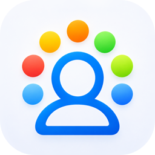
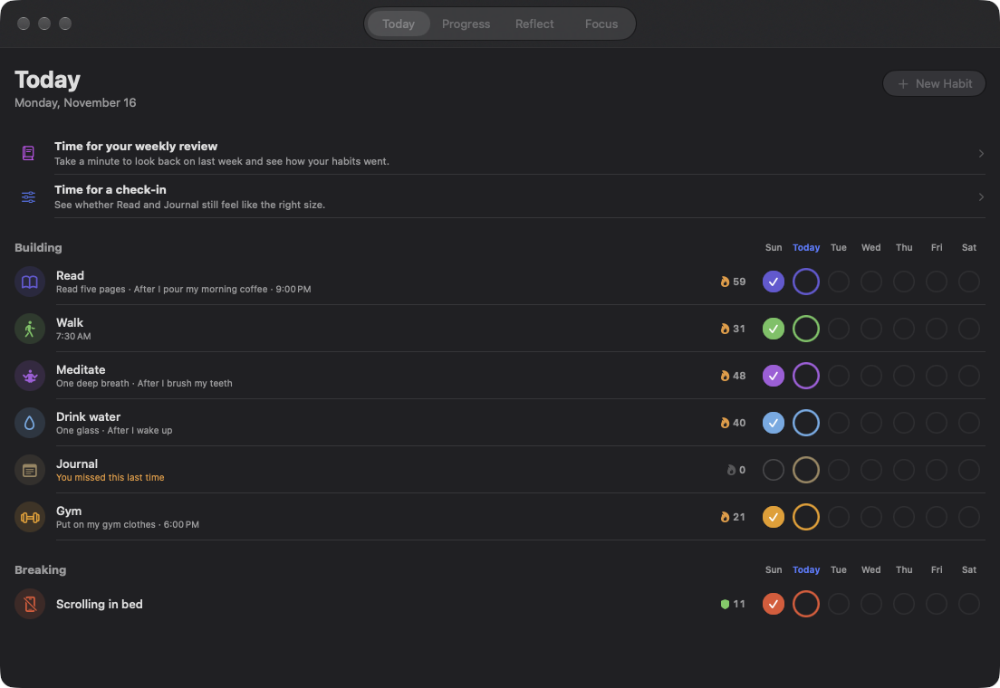
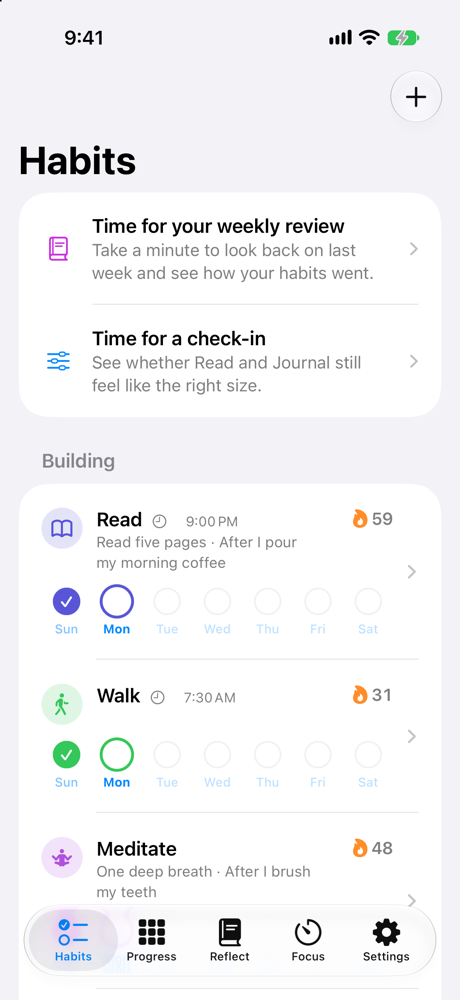
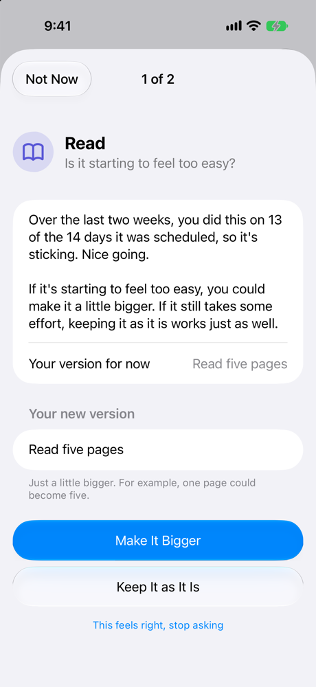
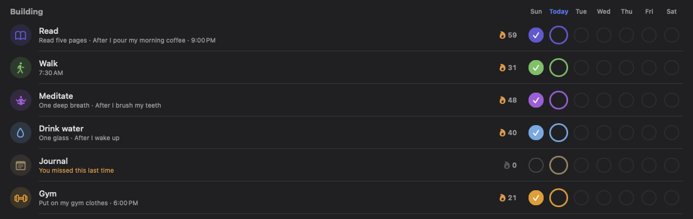
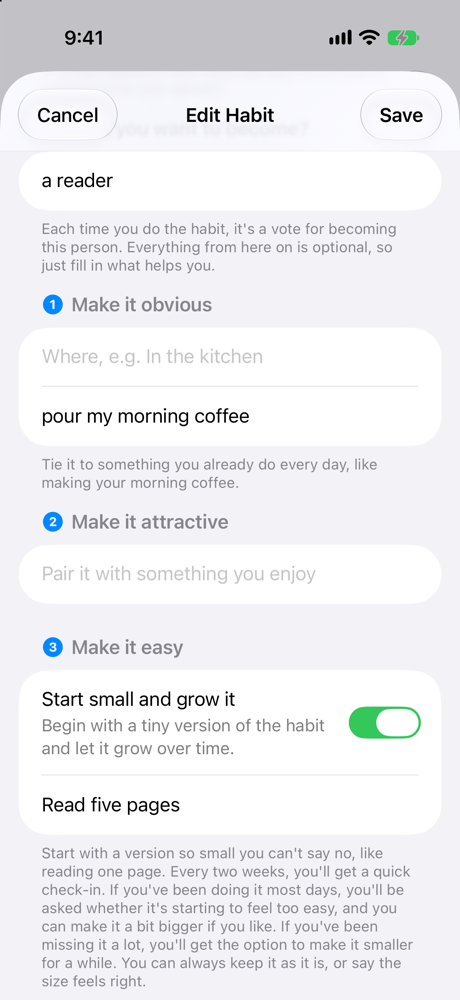
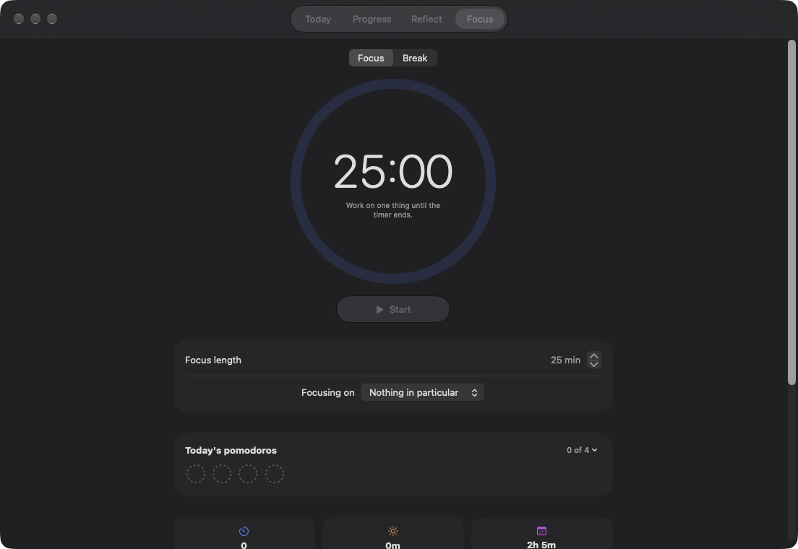
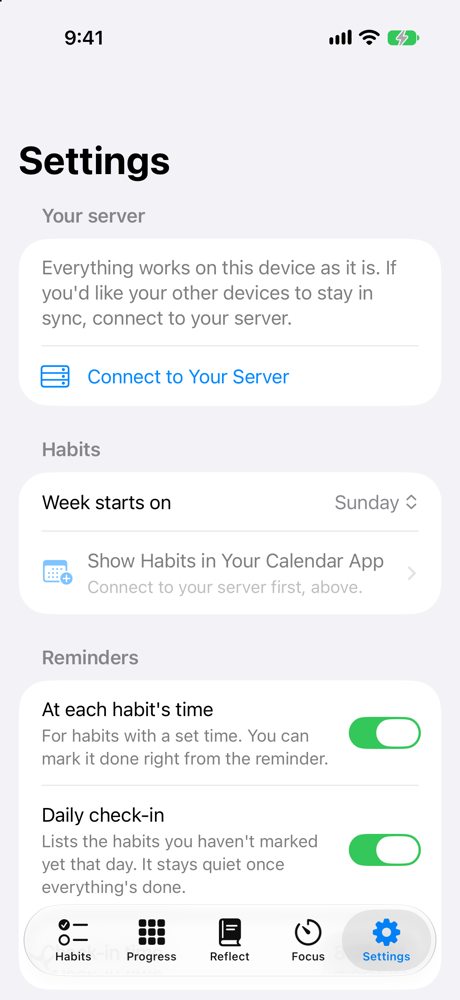
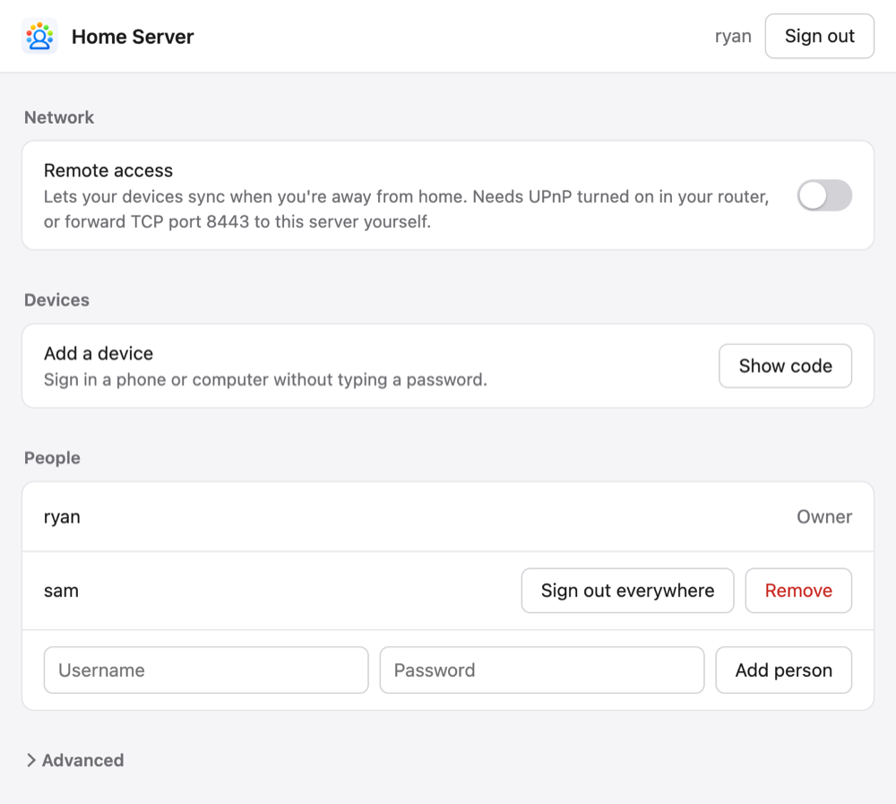

  

<h1 align="center">OpenHabits</h1>

  <strong>Build better habits, one small step at a time.</strong> 
  A habit tracker built around <em>Atomic Habits</em>, that keeps your data on a server you own.

  iPhone · iPad · Mac · Windows · Linux

  

> **This is a beta.** OpenHabits 0.1 is the first public release, so expect a few rough edges. Ideas and bug reports are very welcome in [Issues](https://github.com/Veggies/openhabits/issues).

## What it does

<table>
<tr>
<td width="50%" align="center">

</td>
<td width="50%">

<h3>Check in each day</h3>

Tick off what you did, right from the list. Habits you're trying to break work the other way round: ticking them off means you stayed clear that day.

</td>
</tr>
<tr>
<td width="50%">

<h3>Start small, then grow</h3>

Begin with a tiny version of a habit, like "read one page". Every couple of weeks the app checks in: if it's sticking, it asks whether you're ready for a little more. If it's been hard, it suggests making it smaller.

</td>
<td width="50%" align="center">

</td>
</tr>
<tr>
<td width="50%" align="center">

</td>
<td width="50%">

<h3>Never miss twice</h3>

Missing one day won't break your streak, but missing two in a row will. When you missed a habit last time, the app says so gently, so you can get back on track.

</td>
</tr>
<tr>
<td width="50%">

<h3>See how it's going</h3>

Every habit gets a square for each week showing how many days you did it, plus a plain summary: going strong, getting there, or struggling.

</td>
<td width="50%" align="center">

</td>
</tr>
<tr>
<td width="50%" align="center">

</td>
<td width="50%">

<h3>Look back each week</h3>

A short weekly review shows how each habit went and asks what went well. A habits scorecard helps you notice the habits you already have.

</td>
</tr>
<tr>
<td width="50%">

<h3>Built around Atomic Habits</h3>

Each habit can carry the ideas from James Clear's book: who you want to become ("I am a reader", with every check-in a vote for that person) and the four laws: make it obvious, attractive, easy and satisfying. For habits you're breaking, they're turned around.

</td>
<td width="50%" align="center">

</td>
</tr>
<tr>
<td width="50%" align="center">

</td>
<td width="50%">

<h3>Focus when it counts</h3>

A focus timer with breaks in between. Link a session to a habit, and see how many you've done today.

</td>
</tr>
<tr>
<td width="50%">

<h3>Reminders and your calendar</h3>

Get a nudge at each habit's time, and mark it done right from the notification. Or get one daily check-in listing what's left. Habits with a time can show up in your calendar app too.

</td>
<td width="50%" align="center">

</td>
</tr>
<tr>
<td width="50%" align="center">

</td>
<td width="50%">

<h3>Your data, on your own server</h3>

Your habits live on a small server you run at home, on a NAS or any always-on computer, and every device keeps in sync with it. Each person in your household gets their own private account. Turn on <em>Remote access</em> and it works away from home too, with nothing extra to set up on your phone. The apps also work offline and catch up when they're back in touch.

</td>
</tr>
</table>

## Get started

### 1. Set up the server

Pick whatever you already run:

| | How |
|---|---|
| **TrueNAS** | *Apps → Discover Apps → ⋮ → Install via YAML*, and paste [this file](deploy/truenas/openhabits.yaml). It's on its way to the official catalog. |
| **Unraid** | Add [this template](deploy/unraid/openhabits.xml) under *Docker → Add Container*. |
| **Synology, QNAP, Portainer, or anything with Docker** | Use [this Compose file](deploy/docker-compose.yml): paste it into your NAS's "Project" or "Stack" page, or run `docker compose up -d`. |

Then open `http://<your-server>:8080` in a browser and create your account. The [server guide](docs/SERVER.md) has more detail.

### 2. Get the app

| | |
|---|---|
| **Windows** | Download the Windows zip from [Releases](https://github.com/Veggies/openhabits/releases), unzip it, and open `openhabits.exe`. If Windows warns about an unknown publisher, choose *More info → Run anyway*. |
| **Linux** | Download the Linux archive from [Releases](https://github.com/Veggies/openhabits/releases), unpack it, and open `openhabits`. |
| **iPhone, iPad and Mac** | Coming soon to the App Store, and to Homebrew for the Mac. |

### 3. Connect

Open the app and enter your server's address, or scan the QR code from *Add a device* on the server's settings page.

## For developers

How it's built, how sync works and how to run the tests: [docs/DEVELOPMENT.md](docs/DEVELOPMENT.md).

## Licence

OpenHabits is open source.

- **The apps** (`apps/apple`, `apps/client`) and the shared sync code
  (`packages/core`) are under the [MIT licence](LICENSE): do anything you like
  with them.
- **The server** (`apps/server`) is under the
  [GNU AGPL v3.0 or later](apps/server/LICENSE): you can use, change and share
  it freely, and if you run a changed version as a service for other people,
  you publish your changes too.
