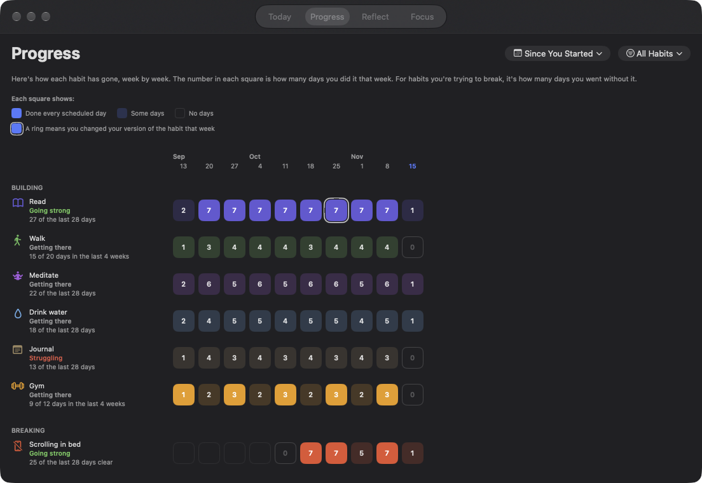
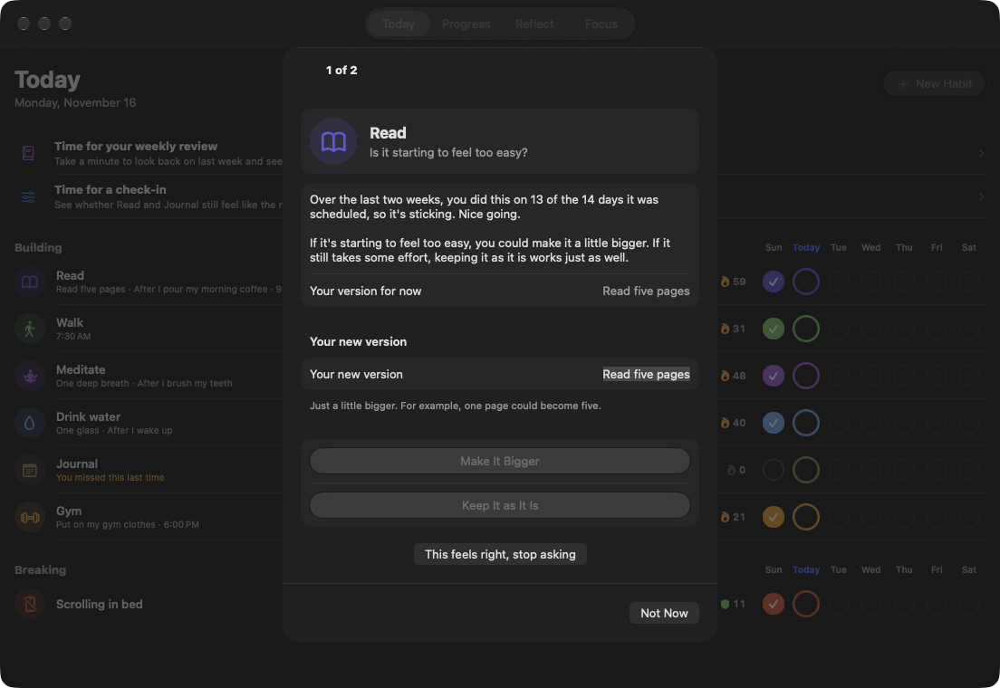
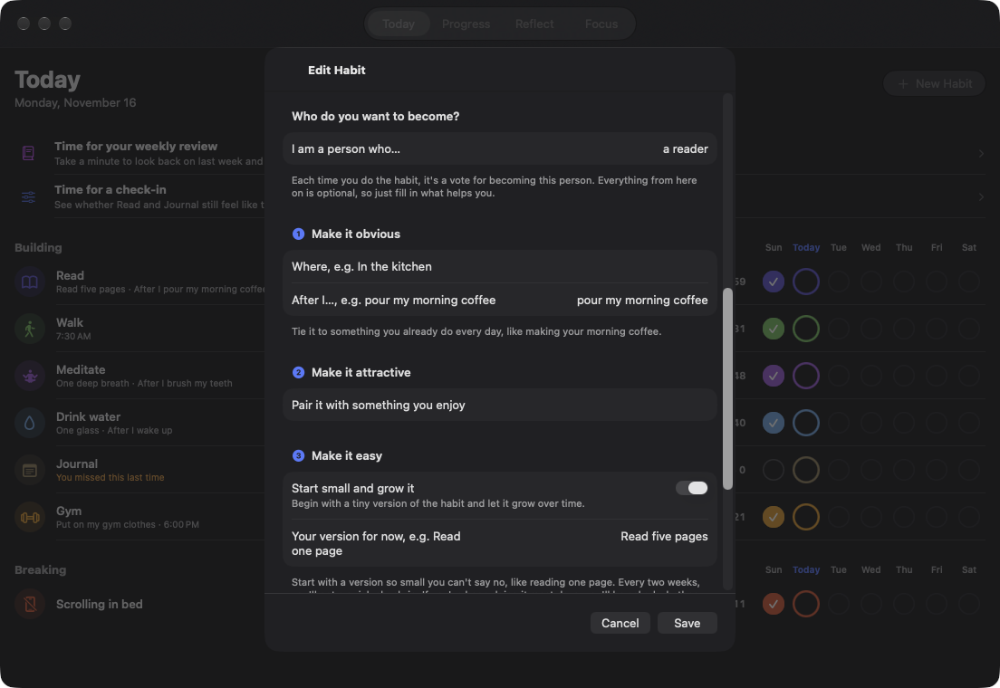
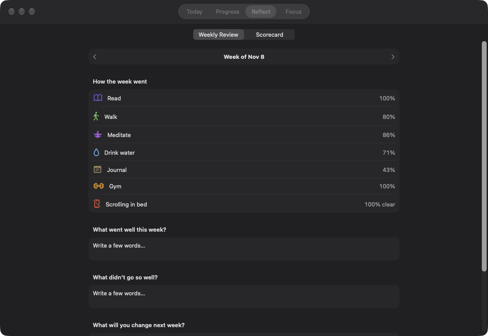

  

<h1 align="center">OpenHabits</h1>

  <strong>Build better habits, one small step at a time.</strong> 
  A habit tracker built around <em>Atomic Habits</em>, that keeps your data on a server you own.

  iPhone · iPad · Mac · Windows · Linux

  

> **This is a beta.** OpenHabits 0.1 is the first public release, so expect a few rough edges. Ideas and bug reports are very welcome in [Issues](https://github.com/Veggies/openhabits/issues).

## What it does

- **Check in each day.** Tick off what you did, or for habits you're breaking, the days you stayed clear.
- **Start small, then grow.** Begin with a tiny version; every couple of weeks the app asks whether it's time for a little more.
- **Never miss twice.** One missed day won't break your streak, and the app nudges you before a second.
- **See how it's going.** A square for every week, and a plain summary of each habit.
- **Look back each week.** A short weekly review, and a scorecard of the habits you already have.
- **Built around Atomic Habits.** Who you want to become, and the four laws, for every habit.
- **Focus timer, reminders and your calendar.** A focus timer with breaks, a nudge at each habit's time, and your habits in your calendar app.
- **Your data, on your own server.** Each person in your household gets a private account, and it works away from home too.

<table>
<tr>
<td align="center"> Progress, week by week</td>
<td align="center"> Start small, then grow</td>
</tr>
<tr>
<td align="center"> Your Atomic Habits plan</td>
<td align="center"> The weekly review</td>
</tr>
<tr>
<td align="center"> Focus timer</td>
<td align="center"> Your server's settings page</td>
</tr>
</table>

## Get started

### 1. Set up the server

Pick whatever you already run:

| | How |
|---|---|
| **TrueNAS** | *Apps → Discover Apps → ⋮ → Install via YAML*, and paste [this file](deploy/truenas/openhabits.yaml). It's on its way to the official catalog. |
| **Unraid** | Add [this template](deploy/unraid/openhabits.xml) under *Docker → Add Container*. |
| **Synology, QNAP, Portainer, or anything with Docker** | Use [this Compose file](deploy/docker-compose.yml): paste it into your NAS's "Project" or "Stack" page, or run `docker compose up -d`. |

Then open `http://<your-server>:8080` in a browser and create your account. The [server guide](docs/SERVER.md) has more detail.

### 2. Get the app

| | |
|---|---|
| **Windows** | Download the Windows zip from [Releases](https://github.com/Veggies/openhabits/releases), unzip it, and open `openhabits.exe`. If Windows warns about an unknown publisher, choose *More info → Run anyway*. |
| **Linux** | Download the Linux archive from [Releases](https://github.com/Veggies/openhabits/releases), unpack it, and open `openhabits`. |
| **iPhone, iPad and Mac** | Coming soon to the App Store, and to Homebrew for the Mac. |

### 3. Connect

Open the app and enter your server's address, or scan the QR code from *Add a device* on the server's settings page.

## For developers

How it's built, how sync works and how to run the tests: [docs/DEVELOPMENT.md](docs/DEVELOPMENT.md).

## Licence

OpenHabits is open source.

- **The apps** (`apps/apple`, `apps/client`) and the shared sync code
  (`packages/core`) are under the [MIT licence](LICENSE): do anything you like
  with them.
- **The server** (`apps/server`) is under the
  [GNU AGPL v3.0 or later](apps/server/LICENSE): you can use, change and share
  it freely, and if you run a changed version as a service for other people,
  you publish your changes too.
