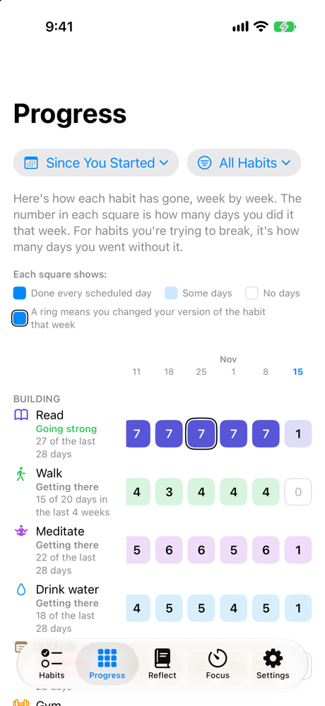
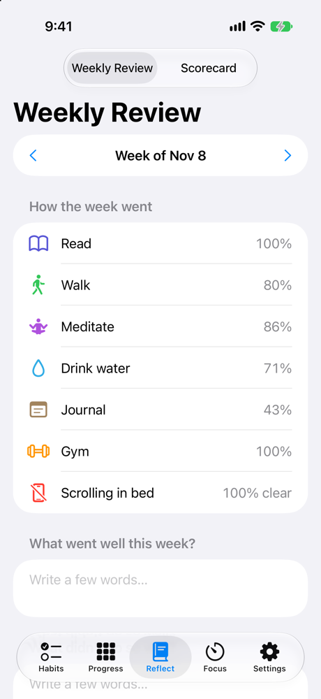
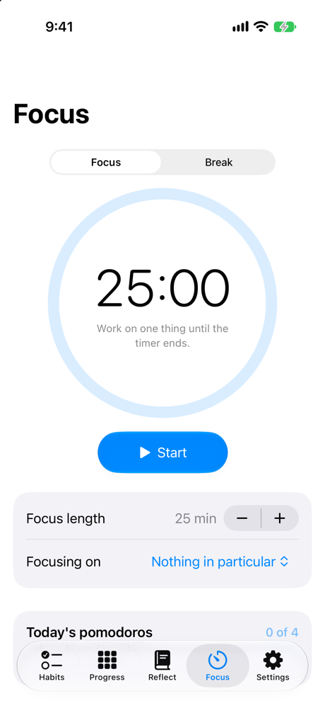

  

<h1 align="center">OpenHabits</h1>

  <strong>Build better habits, one small step at a time.</strong> 
  A habit tracker built around <em>Atomic Habits</em>, that keeps your data on a server you own.

  iPhone · iPad · Mac · Windows · Linux

  

> **This is a beta.** OpenHabits 0.1 is the first public release, so expect a few rough edges. Ideas and bug reports are very welcome in [Issues](https://github.com/Veggies/openhabits/issues).

## What it does

**Check in each day.** Tick off what you did. Habits you're trying to break work the other way round: ticking them off means you stayed clear that day.

**Start small, then grow.** Begin with a tiny version of a habit, like "read one page". Every couple of weeks the app checks in: if it's sticking, it asks whether you're ready for a bit more; if it's been hard, it suggests making it smaller.

**Never miss twice.** Missing a single day won't break your streak. Missing two in a row will, and the app gives you a gentle nudge before that happens.

**See how it's going.** Every habit gets one square per week showing how many days you did it, plus a plain summary: going strong, getting there, or struggling.

**Look back each week.** A short weekly review asks how the week went, and a habits scorecard helps you notice what you already do.

**Focus when it counts.** A built-in focus timer, with breaks, that you can link to a habit.

**Reminders and your calendar.** Get a nudge at each habit's time, or a daily check-in. Habits with a time can show up in your calendar app too.

  
  
  
  

## Built around Atomic Habits

Every habit can carry the ideas from James Clear's book:

- **Who you want to become.** "I am a reader." Each check-in counts as a vote for that person.
- **The four laws.** Make it obvious (when and where, "After I…"), attractive (pair it with something you enjoy), easy (the tiny version) and satisfying (a reward right after). For habits you're breaking, they're turned around, with an optional habit contract.

  
  

## Your data, your server

OpenHabits doesn't have an account with us, because there's no "us". Your habits live on a small server you run at home, on a NAS or any always-on computer, and every device keeps in sync with it. Each person in your household gets their own private account.

The apps work offline too: changes wait on the device and sync when it's back in touch.

**Away from home?** Turn on *Remote access* on the server's settings page and it handles the rest: it asks your router to open a port and keeps a secure connection your devices trust. If your home's internet address changes, your devices find it again automatically.

## Get started

### 1. Set up the server

Pick whatever you already run:

| | How |
|---|---|
| **TrueNAS** | *Apps → Discover Apps → ⋮ → Install via YAML*, and paste [this file](deploy/truenas/openhabits.yaml). It's on its way to the official catalog. |
| **Unraid** | Add [this template](deploy/unraid/openhabits.xml) under *Docker → Add Container*. |
| **Synology, QNAP, Portainer, or anything with Docker** | Use [this Compose file](deploy/docker-compose.yml): paste it into your NAS's "Project" or "Stack" page, or run `docker compose up -d`. |

Then open `http://<your-server>:8080` in a browser and create your account. The [server guide](docs/SERVER.md) has more detail.

### 2. Get the app

| | |
|---|---|
| **Windows** | Download the Windows zip from [Releases](https://github.com/Veggies/openhabits/releases), unzip it, and open `openhabits.exe`. If Windows warns about an unknown publisher, choose *More info → Run anyway*. |
| **Linux** | Download the Linux archive from [Releases](https://github.com/Veggies/openhabits/releases), unpack it, and open `openhabits`. |
| **iPhone, iPad and Mac** | Coming soon to the App Store, and to Homebrew for the Mac. |

### 3. Connect

Open the app and enter your server's address, or scan the QR code from *Add a device* on the server's settings page.

## For developers

How it's built, how sync works and how to run the tests: [docs/DEVELOPMENT.md](docs/DEVELOPMENT.md).

## Licence

OpenHabits is open source.

- **The apps** (`apps/apple`, `apps/client`) and the shared sync code
  (`packages/core`) are under the [MIT licence](LICENSE): do anything you like
  with them.
- **The server** (`apps/server`) is under the
  [GNU AGPL v3.0 or later](apps/server/LICENSE): you can use, change and share
  it freely, and if you run a changed version as a service for other people,
  you publish your changes too.
